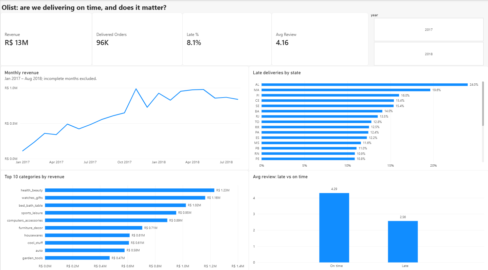

# Olist Data Platform

An end-to-end data pipeline on the Olist Brazilian e-commerce dataset (~100k orders, 2016-2018): raw CSVs → **Bronze / Silver / Gold** Delta tables with **PySpark on Databricks** → a **star schema** → a **Power BI** dashboard.



## Architecture

```
9 raw CSVs (Kaggle)
      │  Databricks volume
      ▼
BRONZE   raw tables, every column as text + _ingested_at, _source_file
      │
      ▼
SILVER   typed, cleaned, deduplicated, no orphan rows      ── checks (row counts, keys, rules)
      │
      ├──► GOLD   monthly_sales · category_performance · delivery_by_state
      │
      └──► GOLD star schema
              fact_orders (1 row per order)   fact_order_items (1 row per item)
              dim_date · dim_customer · dim_product
                    │
                    ▼
              Power BI dashboard
```

| Notebook | What it does |
|---|---|
| [`01_medallion_pipeline`](notebooks/01_medallion_pipeline.ipynb) | Bronze → Silver → Gold in PySpark, with data checks |
| [`02_star_schema_and_analysis`](notebooks/02_star_schema_and_analysis.ipynb) | star schema, reconciliation checks, 5 business questions in SQL, CSV export |
| [`powerbi/olist_dashboard.pbix`](powerbi/olist_dashboard.pbix) | Power BI report on the star schema |

## Cleaning (Silver)

| Table | Main decisions |
|---|---|
| orders | parse 5 date columns; drop 9 delivered orders with no delivery date; flag 23 with impossible date order; add `delivery_days`, `is_late` |
| order_items | cast prices; flag IQR price/freight outliers instead of dropping them (expensive items are real sales) |
| payments | drop 3 `not_defined` payments; fix 2 rows with 0 instalments; keep zero-value vouchers |
| reviews | keep the latest review per order (window function), 551 older ones dropped |
| products | fix misspelled columns; English category names; mark 610 products with no listing data |
| all | remove orphan rows left by dropped orders (`left_anti` to count, `left_semi` to keep) |

Every run ends with checks that stop the pipeline if something is wrong: row counts match an earlier pandas version of the cleaning, primary keys are unique, there are no orphan keys, and business rules hold (review scores 1-5, positive prices).

## Star schema

- **Two fact tables at different grains.** `fact_orders` (99,432 rows, one per order) holds delivery time, lateness, review score and order value. `fact_order_items` (112,641 rows, one per item) holds product and price. Product can't live at order level, and reviews would be double-counted at item level.
- **Aggregate before joining.** Items and payments are summed to one row per order before joining, so values aren't multiplied (2 items × 2 payments would give 4 rows).
- **Shared dimensions:** `dim_date` (one row per day, including days without orders), `dim_customer`, `dim_product`.
- **Reconciliation:** delivered revenue is R$ 13,220,069.93 whether it's calculated from `fact_orders`, `fact_order_items` or `gold.monthly_sales`.

## Findings

| | |
|---|---|
| **Late deliveries hurt reviews** | late orders average **2.56★** vs **4.29★** on time; 8.1% of delivered orders are late |
| **Lateness is regional** | north-east states are worst (AL **24%** late, MA **20%**), but they're small; RJ has far more late orders in total (~1,670), so rate × volume matters |
| **Delivery time is skewed** | median **10** days, mean 12.1, 90% within 23 days, worst 209 |
| **Seasonality** | revenue peaked in **Nov 2017** (Black Friday, ~R$ 988k) |
| **Data trap** | 2016 and the months after Aug 2018 are incomplete (the export ends mid-period), so the dashboard is filtered to Jan 2017 – Aug 2018 |

## Dashboard

One page built on the star schema: KPI cards (revenue, delivered orders, late %, average review), monthly revenue, late % by state, top 10 categories by revenue, and average review for late vs on-time orders. Measures are written in DAX (e.g. `Late % = CALCULATE(AVERAGE(fact_orders[is_late_flag]), fact_orders[order_status] = "delivered")`).

## How to run

1. Download the dataset from [Kaggle: Brazilian E-Commerce Public Dataset by Olist](https://www.kaggle.com/datasets/olistbr/brazilian-ecommerce).
2. In Databricks (Free Edition works): create the volume `workspace.default.olist_raw` and upload the 9 CSVs.
3. Import and run `notebooks/01_medallion_pipeline.ipynb`, then `notebooks/02_star_schema_and_analysis.ipynb`.
4. Download the 5 CSVs from `workspace.gold.exports` and open `powerbi/olist_dashboard.pbix` in Power BI Desktop (or connect it straight to Databricks with the Azure Databricks connector).

## Tech

PySpark · Delta Lake · Databricks (Unity Catalog, volumes, serverless) · Spark SQL · Power BI (DAX, star schema)

## Next steps

- Sellers and geolocation tables in Silver
- Orchestrate the notebooks as a scheduled job (Databricks Workflows or Azure Data Factory)
- A model to predict late deliveries from the Silver data

## Data

Olist dataset, [CC BY-NC-SA 4.0](https://creativecommons.org/licenses/by-nc-sa/4.0/). The raw data isn't included in this repository.
